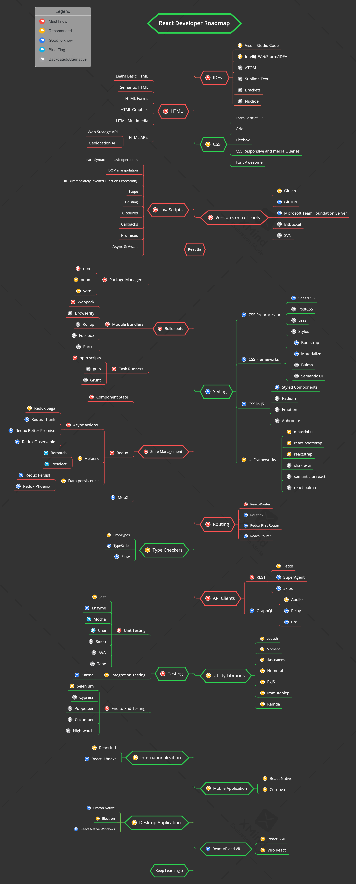

# React Developer Roadmap

> A practical, developer-focused **roadmap** to becoming a **React Developer** in 2026 — covering the essential tools, libraries, and concepts you need along the way.

Below you can find a chart demonstrating the paths that you can take and the libraries that you would want to learn to become a React developer. I made this chart as a tip for everyone who asks me, "What should I learn next as a React developer?"

## Table of Contents

| No. | Topic                                                                  |
| --- | ---------------------------------------------------------------------- |
| 1   | [Disclaimer](#1-disclaimer)                                            |
| 2   | [Roadmap](#2-roadmap)                                                  |
| 3   | [IDEs](#3-ides)                                                        |
| 4   | [HTML](#4-html)                                                        |
| 5   | [CSS](#5-css)                                                          |
| 6   | [JavaScript](#6-javascript)                                            |
| 7   | [React](#7-react)                                                      |
| 8   | [Routing](#8-routing)                                                  |
| 9   | [Build Tools](#9-build-tools)                                          |
| 10  | [UI Design](#10-ui-design)                                             |
| 11  | [API Clients](#11-api-clients)                                         |
| 12  | [Fundamental 3rd Parties](#12-fundamental-3rd-parties)                 |
| 13  | [State Management](#13-state-management)                               |
| 14  | [Architecture](#14-architecture)                                       |
| 15  | [Coding Style](#15-coding-style)                                       |
| 16  | [Utility Libraries](#16-utility-libraries)                             |
| 17  | [Testing](#17-testing)                                                 |
| 18  | [Internationalization](#18-internationalization)                       |
| 19  | [Progressive Web Apps](#19-progressive-web-apps)                       |
| 20  | [Server-Side Rendering](#20-server-side-rendering)                     |
| 21  | [Mobile Application Development](#21-mobile-application-development)   |
| 22  | [Desktop Application Development](#22-desktop-application-development) |

## 1. Disclaimer

> The purpose of this roadmap is to give you an idea about the landscape. The road map will guide you if you are confused about what to learn next, rather than encouraging you to pick what is hip and trendy. You should grow some understanding of why one tool would be better suited for some cases than the other and remember hip and trendy does not always mean best suited for the job

**[⬆ Back to Top](#table-of-contents)**

## 2. Roadmap

    

**[⬆ Back to Top](#table-of-contents)**

## 3. IDEs

| IDE                                                          | Short Description                                   | Pricing      |
| ------------------------------------------------------------ | --------------------------------------------------- | ------------ |
| [Visual Studio Code](https://code.visualstudio.com/Download) | Lightweight and highly extensible code editor.      | **Free**     |
| [WebStorm](https://www.jetbrains.com/webstorm/)              | Powerful IDE for modern JavaScript development.     | **Paid**     |
| [Bolt](https://bolt.new/)                                    | AI-powered tool for building web applications.      | **Freemium** |
| [Cursor](https://www.cursor.com/)                            | AI-powered code editor with smart assistance.       | **Freemium** |
| [Sublime Text](https://www.sublimetext.com/)                 | Fast and customizable lightweight editor.           | **Paid**     |
| [Atom](https://atom.io/)                                     | Open-source and highly customizable code editor.    | **Free**     |
| [Brackets](http://brackets.io/)                              | Frontend-focused editor with live preview.          | **Free**     |
| [Eclipse](https://www.eclipse.org/)                          | Extensible IDE for Java and enterprise development. | **Free**     |

**[⬆ Back to Top](#table-of-contents)**

## 4. HTML

- [w3schools](https://www.w3schools.com/html/) HTML Tutorial
- [MDN Web Docs](https://developer.mozilla.org/en-US/docs/Web/HTML) HTML: HyperText Markup Language

**[⬆ Back to Top](#table-of-contents)**

## 5. CSS

- [w3schools](https://www.w3schools.com/css/) CSS Tutorial
- [MDN Web Docs](https://developer.mozilla.org/en-US/docs/Web/CSS) CSS: Cascading Style Sheets
- [fontawesome](https://fontawesome.com/) Official website
- [w3schools](https://www.w3schools.com/icons/icons_reference.asp) Icons Reference

**[⬆ Back to Top](#table-of-contents)**

## 6. JavaScript

_Basic_

- [w3schools](https://www.w3schools.com/js/default.asp) JavaScript Tutorial
- [developer.mozilla](https://developer.mozilla.org/en-US/docs/Web/JavaScript) JavaScript
- [javascript.info](https://javascript.info/) The Modern JavaScript Tutorial
- [htmlcheatsheet](https://htmlcheatsheet.com/js/) JS CheatSheet

_ES6_

- [exploringjs](https://exploringjs.com/es6/index.html) Exploring ES6
- [compat-table](https://compat-table.github.io/compat-table/es6/) ECMAScript 6 compatibility table
- [babeljs](https://babeljs.io/docs/en/learn) Learn ES2015
- [github](https://github.com/lukehoban/es6features) ECMAScript 6
- [github](https://github.com/sudheerj/ECMAScript-features) ECMAScript 6

_Style Guide_

- [github](https://github.com/airbnb/javascript) Airbnb JavaScript Style Guide
- [github](https://github.com/ryanmcdermott/clean-code-javascript) clean-code-javascript

_Playground_

- [js-array-playground](https://js-array-playground.firebaseapp.com/) JavaScript Array Playground
- [jsfiddle](https://jsfiddle.net/)
- [plnkr](https://plnkr.co/)
- [jsbin](https://jsbin.com/?html,output)
- [codepen](https://codepen.io/pen/)
- [stackblitz](https://stackblitz.com/)

**[⬆ Back to Top](#table-of-contents)**

## 7. React

- [Official website](https://react.dev/)
- [Learn React](https://react.dev/learn)
- [React cheatsheet](https://devhints.io/react)
- [React + TypeScript Cheatsheets](https://react-typescript-cheatsheet.netlify.app/)
- [React Patterns](https://reactpatterns.com)
- [Using React in Visual Studio Code](https://code.visualstudio.com/docs/nodejs/reactjs-tutorial)

**[⬆ Back to Top](#table-of-contents)**

## 8. Routing

- [React Router](https://reactrouter.com/)
- [TanStack Router](https://tanstack.com/router/latest)

**[⬆ Back to Top](#table-of-contents)**

## 9. Build Tools

- Package Managers
  - [npm](https://www.npmjs.com/)
  - [yarn](https://yarnpkg.com/)
  - [pnpm](https://pnpm.io/)
- Module Bundlers
  - [Vite](https://vitejs.dev/)
  - [esbuild](https://esbuild.github.io/)
  - [Turbopack](https://nextjs.org/docs/app/api-reference/turbopack)
  - [Rspack](https://rspack.dev/)
  - [Webpack](https://webpack.js.org/)
  - [Rollup](https://rollupjs.org/)
  - [Bazel](https://bazel.build/)
- Task Runners
  - [npm scripts](https://docs.npmjs.com/misc/scripts)
  - [gulp](https://gulpjs.com/)
  - [grunt](https://gruntjs.com/)

**[⬆ Back to Top](#table-of-contents)**

## 10. UI Design

- CSS Preprocessor
  - [Sass/CSS](https://sass-lang.com/)
  - [PostCSS](https://postcss.org/)
  - [Less](http://lesscss.org/)
  - [Stylus](http://stylus-lang.com/)
- CSS Frameworks
  - [Tailwind CSS](https://tailwindcss.com/)
  - [Bootstrap](https://getbootstrap.com/)
  - [Bulma](https://bulma.io/)
  - [DaisyUI](https://daisyui.com/)
  - [Semantic UI](https://semantic-ui.com/)
- CSS in JS
  - [Styled Components](https://styled-components.com/)
  - [Emotion](https://emotion.sh/)
  - [Panda CSS](https://panda-css.com/)
  - [vanilla-extract](https://vanilla-extract.style/)
  - [Linaria](https://linaria.dev/)
- UI Frameworks
  - [MUI](https://mui.com/) - Material Design React components
  - [Ant Design](https://ant.design/) - Enterprise-class React UI components
  - [shadcn/ui](https://ui.shadcn.com/) - Beautifully designed components built on Radix UI and Tailwind CSS
  - [Chakra UI](https://chakra-ui.com/) - Simple, Modular & Accessible UI Components
  - [Mantine](https://mantine.dev/) - Fully featured React components library
  - [Radix UI](https://www.radix-ui.com/) - Unstyled, accessible components for building design systems
  - [Headless UI](https://headlessui.com/) - Completely unstyled, accessible UI components
  - [react-bootstrap](https://react-bootstrap.github.io/) - Bootstrap components built with React

**[⬆ Back to Top](#table-of-contents)**

## 11. API Clients

- REST
  - [Fetch](https://developer.mozilla.org/en-US/docs/Web/API/Fetch_API)
  - [axios](https://github.com/axios/axios)
  - [ky](https://github.com/sindresorhus/ky)
  - [TanStack Query](https://tanstack.com/query/latest)
  - [SWR](https://swr.vercel.app/)
- GraphQL
  - [Apollo Client](https://www.apollographql.com/docs/react/)
  - [Relay](https://facebook.github.io/relay/)
  - [urql](https://github.com/FormidableLabs/urql)

**[⬆ Back to Top](#table-of-contents)**

## 12. Fundamental 3rd Parties

- TypeScript
  - ["TypeScript Deep Dive"](https://github.com/basarat/typescript-book)
  - [Typescript Docs](https://www.typescriptlang.org/docs/)
- RxJS
  - [The introduction to Reactive Programming](https://gist.github.com/staltz/868e7e9bc2a7b8c1f754)
  - [RxJS manual](https://rxjs.dev/guide/overview)
  - [RxJS In-Depth (video)](https://www.youtube.com/watch?v=KOOT7BArVHQ)

**[⬆ Back to Top](#table-of-contents)**

## 13. State Management

- [Component State](https://react.dev/learn/state-a-components-memory)/[Context API](https://react.dev/learn/passing-data-deeply-with-context)
- [Redux Toolkit](https://redux-toolkit.js.org/)
  - Async actions (Side Effects)
    - [Redux Thunk](https://github.com/reduxjs/redux-thunk)
    - [Redux Saga](https://redux-saga.js.org/)
    - [Redux Observable](https://redux-observable.js.org)
  - Helpers
    - [Reselect](https://github.com/reduxjs/reselect)
    - [Immer](https://immerjs.github.io/immer/)
  - Data persistence
    - [Redux Persist](https://github.com/rt2zz/redux-persist)
- [Zustand](https://zustand.docs.pmnd.rs/)
- [MobX](https://mobx.js.org/)
- [Jotai](https://jotai.org/)
- [XState](https://xstate.js.org/)

**[⬆ Back to Top](#table-of-contents)**

## 14. Architecture

- [Thinking in React](https://react.dev/learn/thinking-in-react)
- [Bulletproof React](https://github.com/alan2207/bulletproof-react) - A scalable, well-organized React architecture
- [Feature-Sliced Design](https://feature-sliced.design/) - Architectural methodology for frontend projects

**[⬆ Back to Top](#table-of-contents)**

## 15. Coding Style

- [Airbnb React Style Guide](https://airbnb.io/javascript/react/)
- [ESLint](https://eslint.org/) with [typescript-eslint](https://typescript-eslint.io/) (replaces the deprecated TSLint)
- [Prettier](https://prettier.io/)

**[⬆ Back to Top](#table-of-contents)**

## 16. Utility Libraries

- [Lodash](https://lodash.com/)
- [Moment](https://momentjs.com/) (maintenance mode – consider [date-fns](https://date-fns.org/), [Day.js](https://day.js.org/), or [Luxon](https://moment.github.io/luxon/))
- [classnames](https://github.com/JedWatson/classnames)/[clsx](https://github.com/lukeed/clsx)
- [Numeral](http://numeraljs.com/)
- [ImmutableJS](https://facebook.github.io/immutable-js/)
- [Ramda](https://ramdajs.com/)

**[⬆ Back to Top](#table-of-contents)**

## 17. Testing

- Unit Testing
  - [Jest](https://jestjs.io/)
  - [Vitest](https://vitest.dev/)
  - [React Testing Library](https://testing-library.com/docs/react-testing-library/intro/)
  - [Storybook](https://storybook.js.org/)
- E2E Testing
  - [Cypress](https://www.cypress.io/)
  - [Playwright](https://playwright.dev/)

> Note: [Enzyme](https://github.com/enzymejs/enzyme) is unmaintained and does not support React 18+ — prefer React Testing Library. [Karma](https://karma-runner.github.io/) is deprecated.

**[⬆ Back to Top](#table-of-contents)**

## 18. Internationalization

- [react-i18next](https://react.i18next.com/)
- [FormatJS (React Intl)](https://formatjs.io/docs/react-intl/)
- [LinguiJS](https://lingui.dev/)

**[⬆ Back to Top](#table-of-contents)**

## 19. Progressive Web Apps

- [Workbox](https://developer.chrome.com/docs/workbox/)
- [vite-plugin-pwa](https://vite-pwa-org.netlify.app/)

**[⬆ Back to Top](#table-of-contents)**

## 20. Server-Side Rendering

- [Next.js](https://nextjs.org/) - The React Framework with SSR/SSG, streaming, and React Server Components
- [React Router (framework mode)](https://reactrouter.com/how-to/pre-rendering) - SSR/SSG (successor of Remix)
- [Gatsby](https://www.gatsbyjs.com/) - Static site generation

**[⬆ Back to Top](#table-of-contents)**

## 21. Mobile Application Development

- [React Native](https://reactnative.dev/)
- [Expo](https://expo.dev/)
- [Ionic React](https://ionicframework.com/docs/react)

**[⬆ Back to Top](#table-of-contents)**

## 22. Desktop Application Development

- [Electron](https://electronjs.org/)
- [Tauri](https://tauri.app/)
- [React Native Windows](https://microsoft.github.io/react-native-windows/)

**[⬆ Back to Top](#table-of-contents)**

## Author

**Md. Saiful Islam**
_Microsoft Certified Solutions Developer (MCSD) – Programming in C#_

**GitHub:** [@saifaustcse](https://github.com/saifaustcse)
**LinkedIn:** [Md. Saiful Islam](https://www.linkedin.com/in/saif-aust-cse/)

If you find this roadmap useful, please give :star:. Your support is appreciated!
